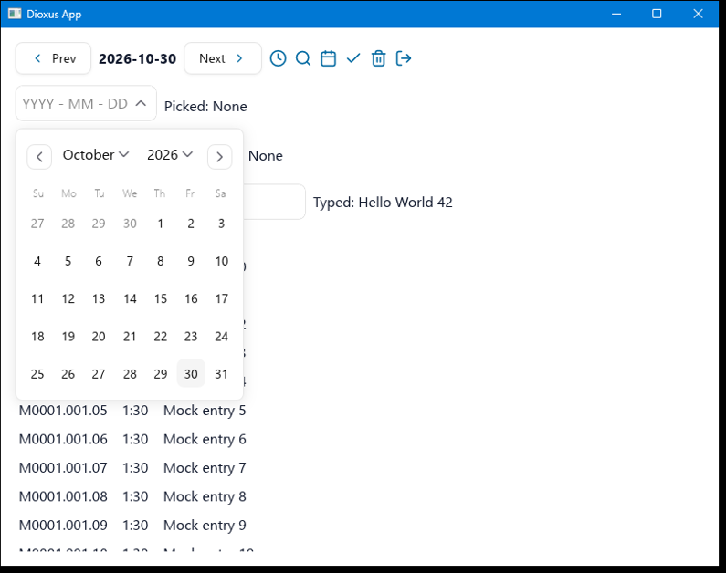
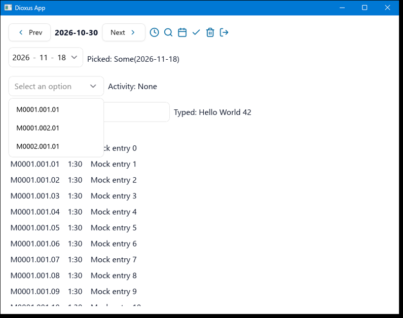
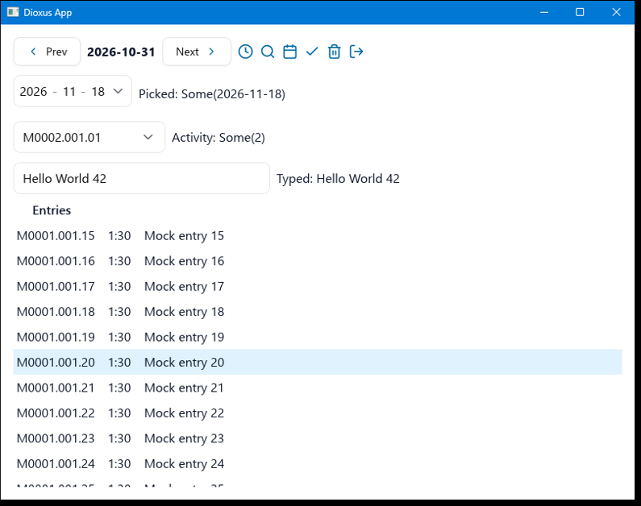

# Blitz spike (M7)

Dioxus Native (Blitz, `dioxus =0.8.0-alpha.3`, `blitz-dom 0.3.0-beta.4`) on Windows 11, with the
official Dioxus components at rev `6b4a1488` and Tailwind v4. All screenshots show mock data.

**Decision: keep Native.** All must-haves pass, with the workarounds below.

The calendar, date picker, popover, select and card were removed later, as no screen used them (Q11 in `docs/open-questions.md`). So workarounds 1 to 3 are no longer in the code; they apply again if those components come back. This records what was tested at the time.

## Must-haves

Checked with a scripted run (`cargo xtask input`, `cargo xtask screenshot`).

| Must-have | Result |
|---|---|
| List renders and scrolls | Pass: `overflow-y-scroll`, mouse wheel, hover highlight |
| Typing works | Pass: value and `oninput` update, also with shift and spaces |
| Buttons work | Pass: previous and next day |
| Select opens, selects, closes | Pass |
| Date picker shows the full month and picks a date | Pass with workarounds 1 to 3, also across months |
| Icons visible | Pass with workaround 4 |
| No crash during the interaction run | Pass with workaround 5 |
| Hover and focus styles | Pass |

Closing by Escape or an outside click was not checked, as the plan does not require it on Blitz.

## Workarounds

The first three and the stroke colours were local changes to the copied components.

1. **Calendar table.** Blitz collapses the `<table>` of the day grid, so only the month header shows.
   `calendar/style.css` lays out the table, rows and cells with flexbox.
2. **Popover position.** Blitz does not place the centred popover correctly and its left part is cut
   off. `date_picker/style.css` anchors it below the field.
3. **Popover alignment.** `DatePickerPopoverContent` uses `ContentAlign::Start` instead of `Center`.
4. **Icon colour.** Icons with `var()` in the `stroke` attribute drew nothing, and some left at the
   default stroke vanished in the styled app. All icons get a concrete `stroke` colour, also in the
   copied components.
5. **Crash on a late stylesheet.** Focus a text input, then open the date picker for the first time:
   the app panics in Stylo (`selector_parser.rs:863`, `Option::unwrap()` on `None`). It happened on
   every attempt, and never after the sheets were loaded at startup by `StylePreload`, which renders
   the components a popover would otherwise load late. `:has()` rules were tried and ruled out.

   Likely cause, read from the source but not confirmed with a backtrace: Blitz records a hover,
   focus, active or checked change in a snapshot without attributes (`attrs: None`). When a sheet
   was added, Stylo's stylesheet invalidation reads the classes of such a snapshot without checking
   for attributes. `css_module` inserts each sheet once, on the first render of its component.

   By this path, **any stylesheet arriving during a pending state change can crash the app**, so
   this is the main risk of the Native choice:
   - Every `css_module` component must render at startup, and no stylesheet may be added later.
   - A window remains: hovering or clicking while the startup sheets load. It was not seen in the
     runs here, and a fix needs Blitz or Stylo; it is worth reporting upstream.

## Fixed: crash on quick clicks across screen changes

Found on 2026-10-31, after the spike: the app panicked in Blitz's hit test (`blitz-dom` `node.rs:1483`, `Option::unwrap()` on `None`), as a pointer event between a DOM change and the next layout met paint lists naming dropped nodes. A scripted loop of Settings, Back and next day crashed it within 2 cycles in 5 of 6 runs, and it also happened once in about a dozen runs with pauses of one to two seconds between clicks.

`vendor/blitz-dom` now carries the upstream fix, see `vendor/README.md`. With it, the same loop survived all 40 cycles in 8 of 8 runs, and 4 of 4 runs of sign-in against the mock, Settings and logout were clean. `apps/desktop/tests/hit_test_dropped_nodes.rs` panics at that same line without the fix. Other crashes of this alpha remain possible: the stylesheet one above is only worked around, and a review provoked a panic in `get_cursor` (`document.rs`) by moving a hoisted child out of a parent and dropping that parent before the next layout. Whether Dioxus ever does that is not known; it was not seen in the app.

## Other findings

- `enigo`'s `text()` sends Unicode packets, which Blitz ignores. `cargo xtask input type` sends real
  key events instead. A real keyboard works; IME input was not tested.
- The binary from a plain `cargo build` runs without any stylesheet. Use `dx build`.
- With `CARGO_MANIFEST_DIR` set in its environment, the `dx`-built app shows a **blank window** with no error (found in M8, while it was set for `xtask.exe`). Launch it without that variable, so not from `cargo run` or a shell that exported it.
- `dx` must run from the workspace root: below it, it panics while resolving `default-members`.
